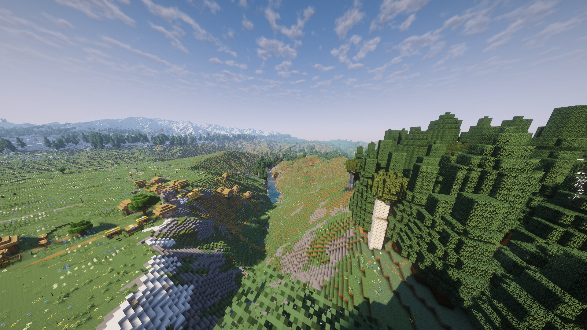
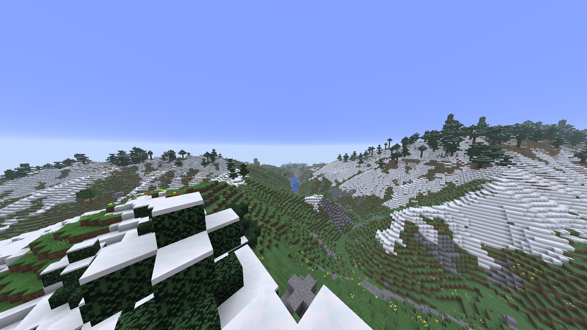
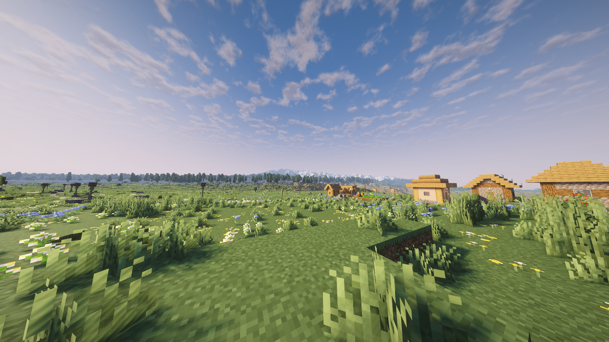
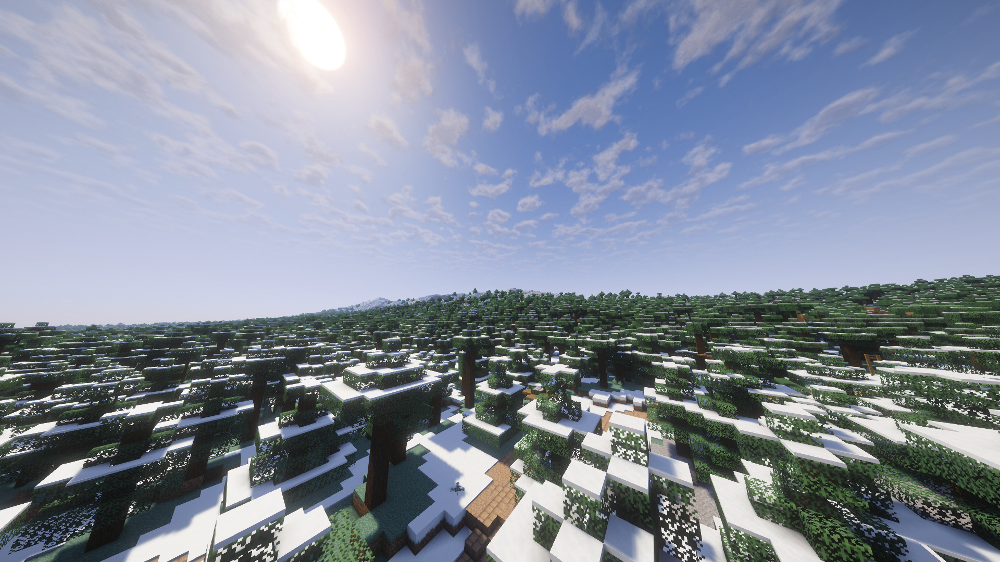
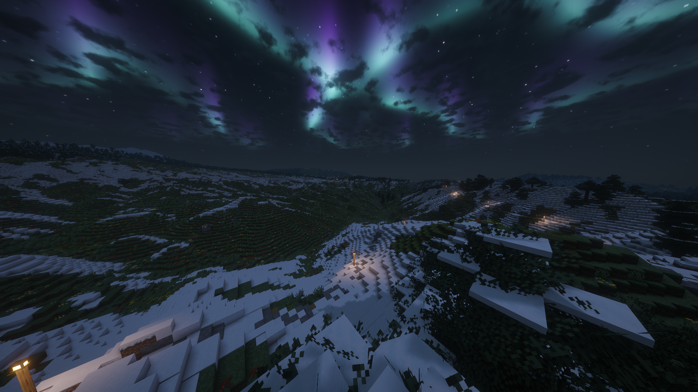

# European Wilderness

European Wilderness is a fork of Alexander Goslin's Terrain Diffusion MC. I made it for players who enjoy the look of Terrain Diffusion and want more to discover as they travel. You can cross dense forests and snowy passes, follow a river down a valley, or set out to find islands.

You can tailor a new world to your liking. Choose how common mountains are, how pronounced their relief is, and how much space open fields, forests and other landscapes take up. If you'd rather start with a preset, try Alps or Scandinavia.

The mod uses ONNX models from Terrain Diffusion MC to generate terrain and climate data. European Wilderness uses that foundation to shape biomes and add trees with custom trunks and crowns. While exploring, you can find fjords, rocky islands, archipelagos and oases.

The original Terrain Diffusion MC does not support Streams Reflowing. That is why I built a separate hydrology system for European Wilderness. River currents can carry boats and dropped items, and you can turn them on or off in the mod settings. I'm still working on rivers, lakes and waterfalls. If you find a bug or have an idea for a future update, I'd like to hear about it. [GitHub Issues](https://github.com/rizonanc/European-Wilderness/issues)

If you enjoy mods about rivers, I also recommend [Streams Reflowing](https://www.curseforge.com/minecraft/mc-mods/streams-reflowing).

You can choose where to spawn using Explorer, a feature inherited from Terrain Diffusion MC.

The screenshots use the Alps preset. Some were taken with shaders and some without. A few were taken at a render distance of 32 chunks with Voxy disabled.

### Screenshots

2048 Voxy Render Distance, Complementary Reimagined ( Visual Style: Unbound )

32 Render Distance, No shaders

2048 Voxy Render Distance, Complementary Reimagined ( Visual Style: Unbound )

2048 Voxy Render Distance, Complementary Reimagined ( Visual Style: Unbound )

 2048 Voxy Render Distance, Complementary Reimagined ( Visual Style: Unbound )

### Requirements and installation

You'll need Windows x64, Java 21, a DirectML-capable GPU, Minecraft 1.21.11, Fabric Loader 0.18.1 or newer, and Fabric API. Put the JAR in your `mods` folder and choose **European Wilderness** as the world type when creating a new world. On first launch, the mod downloads and verifies about 2.3 GB of terrain models from Hugging Face.

### Compatibility

The mod integrates with Road Weaver and supports selected decorations from Wilder Wild and Geophilic. These mods are optional and installed separately, as are Voxy and Mod Menu. [Road Weaver](https://www.curseforge.com/minecraft/mc-mods/roadweaver) · [Wilder Wild](https://www.curseforge.com/minecraft/mc-mods/wilder-wild) · [Geophilic](https://www.curseforge.com/minecraft/mc-mods/geophilic) · [Iris Shaders](https://www.curseforge.com/minecraft/mc-mods/irisshaders)

I recommend Voxy for longer views and [Chunky](https://www.curseforge.com/minecraft/mc-mods/chunky-pregenerator) for pre-generating chunks. If you'd like more variety in vegetation and ground decoration, try Wilder Wild and Geophilic.

### Credits

Thanks to Alexander Goslin for Terrain Diffusion MC and its terrain models, and to Joao for DirectML support in the original project. European Wilderness is distributed under the MIT license. [Terrain Diffusion MC](https://github.com/xandergos/terrain-diffusion-mc) · [Terrain models](https://huggingface.co/xandergos/terrain-diffusion-30m-onnx) · [Joao](https://github.com/batata1-jg)

## Upgrade

Replace the old mod JAR. Existing worlds keep their mod and world-generation IDs. On first use, the mod copies older settings to `config/european-wilderness.properties` and menu preferences to `config/european-wilderness-menu.json`. It reuses any existing model directory. Back up your world before updating.

## Build

Run `./gradlew build` with JDK 21, or `gradlew.bat build` on Windows. The JAR is in `build/libs/`. The build bundles the upstream Windows DirectML runtime.

## Development

- `./gradlew spotlessApply`
- `./gradlew check`

[MIT license](LICENSE.txt) · [Third-party notices](licenses/)

**This mod was developed with AI assistance.**
